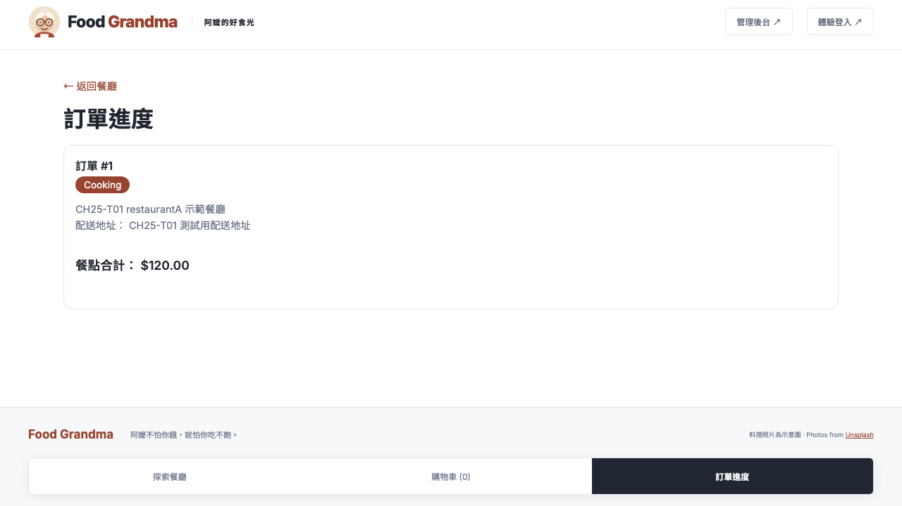

# 第 25 章：顧客訂餐的三種流程寫法

2026 年 11 月 5 日（台灣時間），將第 25 章改為顧客使用 Food Grandma 訂餐的案例。三版都經過搜尋餐廳、開啟菜單、選擇餐點及加入購物車、查看購物車、前往結帳、填寫配送地址與送出訂單。

程式碼集中在 [customer-order.spec.ts](../../../tests/e2e/chapters/ch19/customer-order.spec.ts)。第一版已使用 POM；三版共用相同的四個頁面物件、資料準備及驗收檢查，只比較流程如何撰寫。「行雲流水模式」是本書採用的 Fluent Interface 中文譯名。

本案例是依現有網站新增的教學情境，不是原始 v1、v2 的輸出，也不把第一版描述為原始 AI 的問題。原始 v1、v2 與之前的完整實驗紀錄保留；更新前的 [第 25 章餐點價格案例](https://github.com/vansleee/grandma-playwright-ai-agent-testing-patterns/blob/a6276029604d8471b2836f61a628f7b95b0144e2/tests/e2e/chapters/ch25/meal-price.spec.ts) 可由 Git 歷史查閱。

## 如何執行

先完成 [章節環境設定](../../../tests/e2e/chapters/README.md#開始執行)，再從範例專案根目錄執行：

```text
cd tests/e2e/chapters
npm run chapter -- 19
```

執行器依序執行 `none`、`fluent`、`workflow`。每版各自複製相同的初始資料庫，再啟動一次 Playwright；顧客沒有既有訂單，購物車為空，餐點為「香煎雞腿便當」、單價 120。餐廳名稱取自章節專用帳號建立的餐廳，配送地址使用測試資料。

## 程式碼的差別

POM 版在測試中逐步呼叫七個頁面方法。行雲流水版保留相同的行為順序，方法先記錄步驟，`run()` 再依序等待每個步驟完成。Workflow Facade 版由 `placeOrder()` 安排同樣的七個方法。

三版的驗收都留在測試的 Assert 段落，透過同一個 `expectOrderPlaced()` 檢查網頁及後端。這個函式只檢查結果，不代替網頁搜尋、加入購物車或送出訂單。

## 實際結果

實驗表 25-1　三種流程寫法的訂餐結果

| 版本 | 執行次數 | 結果 | 訂單 POST | 訂單數量 | 餐點數量／總額 |
| --- | --- | --- | --- | --- | --- |
| 逐步呼叫 POM | 1 | 通過 | HTTP 200，`status: success` | 1 | 1／120 |
| 行雲流水模式 | 1 | 通過 | HTTP 200，`status: success` | 1 | 1／120 |
| Workflow Facade | 1 | 通過 | HTTP 200，`status: success` | 1 | 1／120 |

三個測試均未重試。每版的畫面操作紀錄都是相同的八個步驟：開啟餐廳列表，以及搜尋、開啟餐廳、加入購物車、查看購物車、結帳、填地址、送出。三份資料庫中的訂單與餐點明細完全一致。

每版留下 15 筆 API 請求紀錄，包含登入、準備餐點、瀏覽器查詢與送出訂單，以及最後的 API 查詢。API 回應均為 2xx，瀏覽器實際送出的訂單回應為 `{"status":"success"}`。網頁上的訂單編號、餐廳、地址及金額，與後端讀回的結果一致；後端也核對餐點編號、數量 1 與明細金額 120。

主控台每版都有一筆 React 不識別 `fetchPriority` 屬性的警告，以 error 等級輸出；另有 React Router 的未來版本警告，均保留在 `console.log`。本輪訂餐驗收通過，沒有將警告當作不存在，也沒有修改網站程式。

TypeScript 檢查通過，執行器建立的獨立服務已停止。這次只重跑第 25 章，沒有重新驗證全部章節，也沒有比較三種寫法的效能。書稿保留本輪開始前的內容，包含作者原有的第 25 章未提交修改。

## 執行畫面


實驗圖 25-1　逐步呼叫 POM 後，網頁顯示本次訂單與金額 120。


實驗圖 25-2　行雲流水版執行同樣的訂購步驟，產生相同的訂單內容。



實驗圖 25-3　Workflow Facade 完成訂購後，仍由測試檢查相同的預期結果。

## 證據位置

[summary.json](summary.json) 列出三版結果；[input-hashes.json](input-hashes.json) 保存本次程式與設定的內容雜湊。每版資料夾保存執行結果、`browser-steps.json`、`requests.jsonl`、API 請求回應、逐筆回應原文、主控台與網路日誌、資料庫結果，以及送出前後的畫面。

`before-submit.jpeg` 取自 trace 中送出按鈕點擊前最近的一張畫面；`after-order.png` 是 Playwright 在測試結束時留下的截圖。完整 trace 保留在本機工作資料夾的 `evidence/`，不加入版本庫；對外紀錄中的密碼及 token 已遮蔽。

重現整段準備、網頁步驟與查詢可使用 [repro.sh](repro.sh)，請在範例專案根目錄執行；Windows PowerShell 直接使用前面的 `npm run chapter -- 19` 指令即可。
