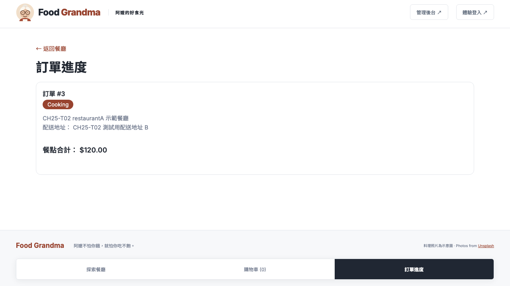

# 第 25 章：使用 Workflow Facade 準備兩筆訂單

2026 年 11 月 6 日（台灣時間），新增 CH25-T02：兩位顧客各透過網頁下一筆訂單，再由餐廳管理者搜尋其中一筆的配送地址。程式與獨立帳號設定見 [第 25 章範例](../../../tests/e2e/chapters/ch19/customer-order.spec.ts)。

沿用相同的 CustomerOrderingWorkflow，兩位顧客分別使用獨立 browser context、登入資料與購物車。搜尋前先確認管理頁面顯示兩筆訂單，搜尋後確認只剩指定訂單。API 用於準備餐點與查詢結果，沒有代替顧客從網頁下單。

## 執行與結果

完成環境設定後，在範例專案根目錄執行：

```text
npm --prefix tests/e2e/chapters run chapter -- 19
```

原有 CH25-T01 的 POM、流暢介面與 Workflow Facade 三版，加上 CH25-T02，共四個測試通過，零重試，型別檢查通過。新測試的兩次瀏覽器訂單 POST 均為 HTTP 200，回應 status 為 success。後端有兩筆不同顧客的訂單，各為一份餐點、金額 120；搜尋結果只顯示地址 A 的訂單。

Fixture 在本次結束時關閉兩位顧客的瀏覽器環境，章節執行器建立的服務也已停止。實測平台為 macOS，未實測 Windows。



實驗圖 25-4　準備兩筆訂單後，餐廳管理者搜尋地址 A，只顯示符合條件的訂單。

## 留存紀錄

- summary.json：四個測試的結果與兩筆訂單內容。
- api-evidence.json：新測試的 API 請求、回應及來源，憑證已遮蔽。
- none/、fluent/、workflow/：原始 Playwright 結果、日誌與執行設定。
- input-hashes.json：已實測的主要程式與設定雜湊。

完整 trace 保留在本機本輪工作資料夾，不加入版本庫。主控台仍有 React fetchPriority 與 Router 開發警告，未藉此修改網站程式。前一次三版本訂餐比較另見 [11 月 5 日紀錄](../ch25-customer-order/README.md)，舊結果與舊名稱反映當時版本，不改寫歷史。
