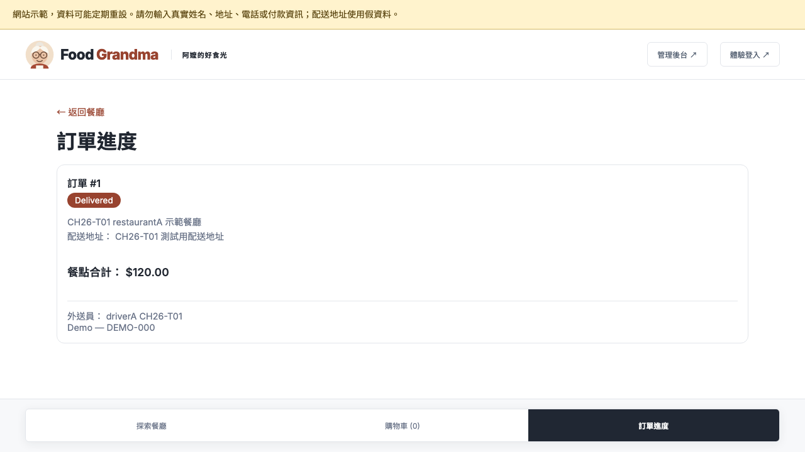
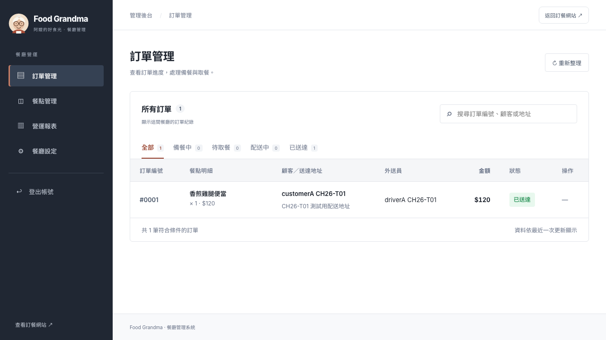
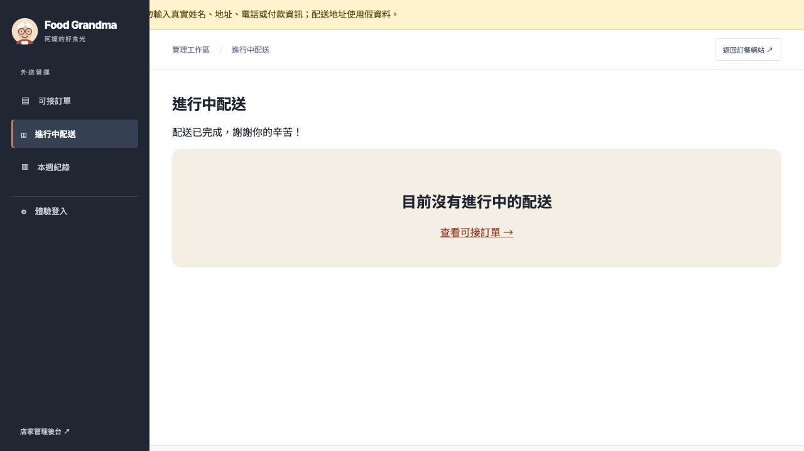

# CH26-T01 多角色訂單流程實測

日期：2026 年 11 月 7 日（台灣時間）。書稿維持本輪開始前的內容，包含作者現有未提交修改。原始 v1、v2 及其他既有練習保持不變。

程式：[multi-role-order.spec.ts](../../../tests/e2e/chapters/ch20/multi-role-order.spec.ts)。來源與設計對照：[SOURCES.md](SOURCES.md)。

## 執行

完成章節環境設定後，從範例專案根目錄執行：

```text
npm --prefix tests/e2e/chapters run chapter -- 20
```

三版各自從相同的初始資料庫開始，每版都建立三個獨立 browser context。沒有共用登入資料或購物車來刻意製造失敗。

實驗表 26-1　三版多角色流程結果

| 版本 | 結果 | 重試 | 網頁修改狀態的請求 | 同一筆訂單的 API 狀態 |
| --- | --- | --- | --- | --- |
| 混合角色責任的 POM | 1 passed | 0 | 4 | Cooking → Ready → Delivered |
| 角色分工的 POM | 1 passed | 0 | 4 | Cooking → Ready → Delivered |
| Screenplay | 1 passed | 0 | 4 | Cooking → Ready → Delivered |

四個狀態修改步驟皆從網頁執行：顧客送出訂單、管理者標記備餐完成、外送員接單、外送員確認已送達。API 只用於準備帳號與餐點、取得外送員資料及查詢訂單，沒有用 API 代替這四個網頁動作。每版 32 筆 API 請求的回應內容與狀態碼均保存，全部為 2xx。

三版均核對同一個訂單編號的三個狀態、原餐點與數量 1、總額 120，以及最後的外送員編號。資料庫的最終訂單及明細相同。顧客頁面顯示 Delivered、管理頁面顯示已送達、外送員沒有進行中的配送。TypeScript 檢查通過，獨立服務已停止。

主控台每版各有一筆 React `fetchPriority` 警告，以 error 等級輸出，另有 Router 開發警告，保留在 `console.json`，未修改產品消除警告。不比較這三次的速度，也不據此推算維護成本。

## 截圖與證據



實驗圖 26-1　顧客頁面顯示同一筆訂單已送達。



實驗圖 26-2　餐廳管理者重新載入後，訂單狀態為已送達。



實驗圖 26-3　外送員確認送達後，進行中的配送列表已無該訂單。

每版資料夾保存 `lifecycle.json`（三次查詢結果）、API 請求回應、主控台、網路日誌、非 2xx 清單、資料庫狀態、三個角色截圖，以及 Playwright 原始結果與執行設定。`summary.json` 統計結果，`input-hashes.json` 記錄主要程式與設定。公開紀錄已遮蔽密碼與 token；完整 trace 留在本機本輪工作資料夾的 `evidence/`。

前一版餐點價格的實測紀錄保持原樣。本輪是新增教學情境，三版不命名為原始 v1、v2，並且保留 POM 角色分工控制組，以確認 POM 本身也能完成相同任務。
