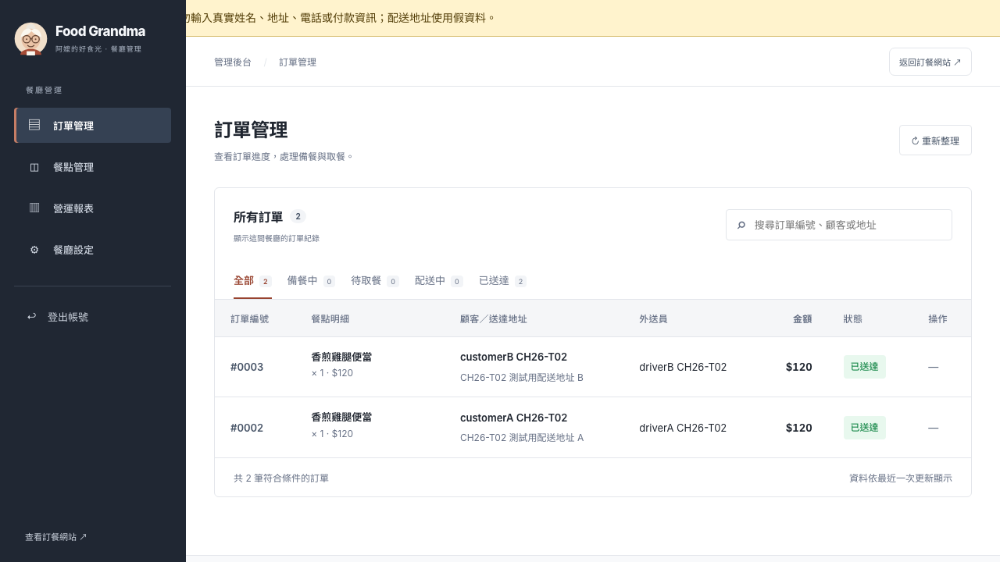
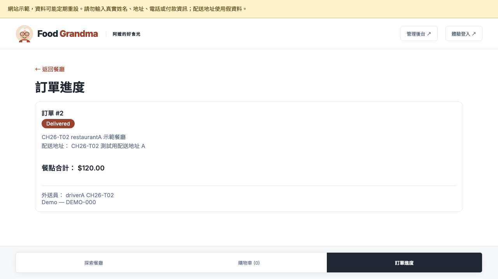

# 第 26 章：review 後的多角色比較與 Task 重組

日期：2026 年 11 月 7 日（台灣時間）。只修改範例與執行紀錄，書稿及作者原有未提交修改保持不變。

## 範例位置與執行

- [主要測試](../../../tests/e2e/chapters/ch20/multi-role-order.spec.ts)：三版 CH26-T01 與新增 CH26-T02，使用 AAA。
- [RoleSessions](../../../tests/e2e/chapters/ch20/role-sessions.ts)：建立及清理角色瀏覽器環境。
- [清理失敗檢查](../../../tests/e2e/chapters/scripts/check-role-sessions.mjs)：載入並執行實際 RoleSessions 程式，使用替身注入失敗，不需啟動網站。

完成既有環境設定後，從範例專案根目錄執行：

```text
npm --prefix tests/e2e/chapters run chapter -- 20
node --test tests/e2e/chapters/scripts/check-role-sessions.mjs
```

## Review 意見與修改

第一版定位改成「責任錯置的教學反例」：將跨角色協調器及查詢能力誤稱為 Page。它不是原始 v1 的錯誤，也不拿十幾行的包裝程式當作 POM 肥大的量測證據。

顧客訂餐拆回 RestaurantsPage、MenuPage、CartPage、CheckoutPage，由 CustomerOrderingWorkflow 安排跨頁步驟。三版共用這些程式；角色分工的 POM 版也是可採用的解法。

Screenplay 的 Task 加上明確名稱，透過 test.step 顯示哪位 Actor 正在做什麼。新增情境重複呼叫 PlaceOrder、MarkOrderReady、ClaimOrder、ConfirmDelivered，不重新撰寫定位器。

RoleSessions Fixture 在子 Fixture 建立角色前就進入 try/finally。建立頁面失敗時，已建立的 context 仍會清理；截圖及附件各自收集失敗結果，不阻止關閉其他環境。截圖有兩秒逾時。關閉失敗時，仍會嘗試其他 context；測試原本已失敗時只補充清理錯誤，不用清理錯誤覆蓋原本錯誤。

## 實際執行結果

實驗表 26-2　Review 後的測試結果

| 類型 | 範圍 | 結果 |
| --- | --- | --- |
| E2E | 責任錯置 POM 的 CH26-T01 | 1 passed |
| E2E | 角色分工 POM 的 CH26-T01 | 1 passed |
| E2E | Screenplay 的 CH26-T01、CH26-T02 | 2 passed |
| 失敗注入檢查 | 部分建立失敗、截圖失敗、附件失敗、部分關閉失敗、保留原始測試錯誤 | 5 passed |

四個 E2E 測試均零重試。三版共同的 CH26-T01 使用相同條件，API 訂單內容相同，並核對 Cooking → Ready → On the way → Delivered 四個階段。金額及餐點價格依 scenario.total 核對，不再在共用驗收函式寫死 120。型別檢查通過。

## 新增兩位顧客與不同外送員

CH26-T02 使用五個獨立 browser context：顧客 A、顧客 B、餐廳管理者、外送員 A、外送員 B。兩位顧客各在網頁下一筆單，管理者分別標記備餐完成，再讓兩位外送員各自接取指定訂單。先由 B 確認送達，此時 A 的同一筆訂單仍為 On the way，外送員仍是 A；最後才讓 A 確認送達。

此測試確認兩筆訂單編號、顧客編號與外送員編號不同，最終都為 Delivered。各顧客頁面顯示自己的訂單，管理者可查到兩筆已送達，兩位外送員的進行中配送列表均為空。

這個新增測試只放在 Screenplay，目的在展示同樣的 Task 如何由不同 Actor 重複組合，不與三版共同案例混算，也不宣稱 POM 無法完成相同情境。



實驗圖 26-4　兩位顧客的訂單都已送達，管理者仍能辨識各自的訂單與地址。



實驗圖 26-5　顧客 A 的頁面顯示自己的訂單已送達。


實驗圖 26-6　顧客 B 的頁面顯示另一筆已送達訂單，沒有共用顧客 A 的登入狀態。

## 證據與限制

summary.json 保存結果，cleanup-tests.log 保存五個失敗注入檢查。每個 E2E 測試各有 API 請求回應、四階段 lifecycle、網路及主控台紀錄、角色截圖。CH26-T02 的 interleaving.json 保存 B 已送達、A 仍配送中的查詢結果。input-hashes.json 記錄本次實測程式與設定內容。

共同案例每版有四次網頁狀態修改，雙顧客案例有八次，回應均為 2xx；API 沒有代替網頁建立訂單、標記備餐完成、接單或確認送達。完整 trace 留在本機工作資料夾的 evidence/。公開紀錄已遮蔽憑證，獨立服務已停止。主控台的 React fetchPriority 及 Router 開發警告仍保留，沒有修改網站程式來消除警告。

前一次 [三版實測](../ch26-multi-role/README.md) 與 [來源查證](../ch26-multi-role/SOURCES.md) 保留原內容。此次為手寫的簡化 Screenplay，沒有安裝 Serenity/JS；來源說明仍適用，但目前將配送 Task 拆成接單與確認送達，以展示任務重組。未量測長期維護成本或速度差異。
