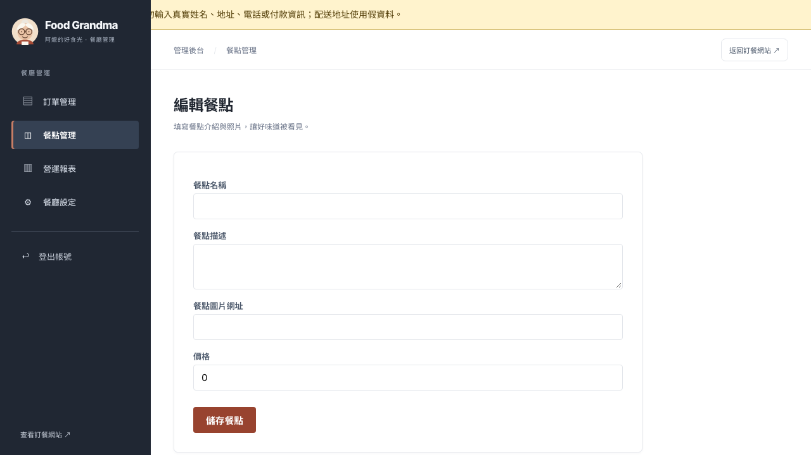
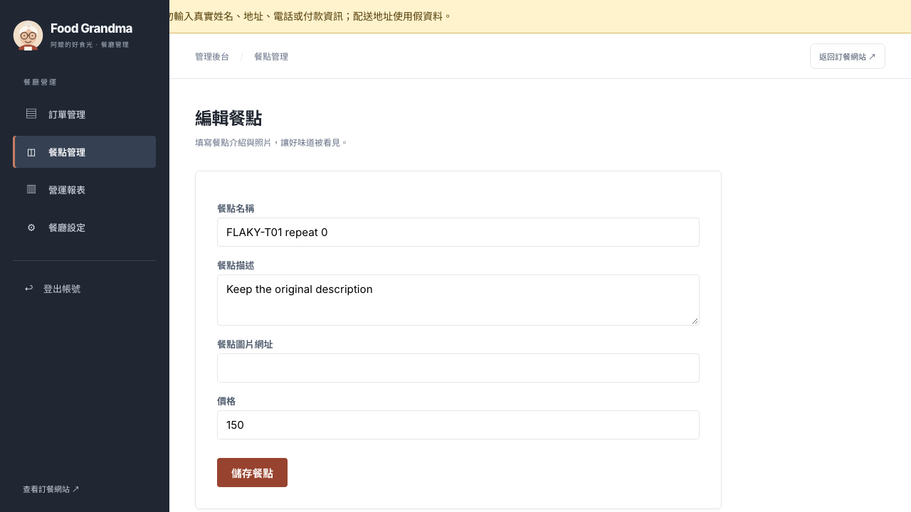

# 第 34、35 章補充實驗：平行執行與 Flaky Test

2026 年 11 月 3 日，台灣時間。以目前 v1 為基礎新增範例，未修改 v1、v2、產品、specs 或書稿。

## 結果

表 1　本次實際執行結果

| 實驗 | 執行方式 | 結果 |
| --- | --- | --- |
| 原始 v1 複本 | 27 個案例，1／4 workers 各三輪 | 六輪都是 26 通過、同一個 ROLE-T02 失敗；沒有新增平行失敗 |
| 共用餐點反例 | 1 worker，一輪兩個案例 | 2 通過 |
| 共用餐點反例 | 2 workers，三輪共六次 | 每輪 1 通過、1 失敗，合計 3 通過、3 失敗 |
| 每個測試各建餐點 | 2 workers，三輪共六次 | 6 通過 |
| 固定等待 200 毫秒 | 1 worker，20 次 | 10 通過、10 失敗 |
| 等價格出現原值 | 同一份延遲順序，20 次 | 20 通過 |

所有執行 retries=0，沒有 skip、fixme 或預期失敗標記。總共 15 輪執行指令、216 次案例執行；事先設定的次數跑完就停止。型別檢查已通過。

## 保留原始版本與實驗條件

原始資料夾是 [v1](../../../tests/e2e/v1)。本次將它複製到 [baseline](baseline)，十份 TypeScript 測試與共用程式逐位元組相同；只用外層設定指定新的執行位置。baseline 自己的原始設定也保留。

新增的 before／after 是這次另外撰寫的教學範例，不是上一輪 AI 原始生成的程式。v1 本來已有獨立案例帳號，也已使用正確的等待方式；本次刻意改變共用資料與等待方式，觀察它們各自造成的結果。

使用 Node.js v26.9.0、Playwright 1.63.0、Chromium、同一台 macOS 電腦與同一份產品程式。每輪從相同的初始資料庫另複製一份，先只有帳號，餐點及訂單為空。API 在 18081，網站在 18082，管理站開發服務在 18880。原本 8081、8082 的服務未重設或停止。

## 第 34 章實驗一：原始 v1 增加 worker

實際步驟：

1. 複製 v1，確認程式內容沒有改變。
2. 使用一個 worker 執行全部 27 個案例，保留每個案例結果與 trace。
3. 另建全新資料庫，改成四個 worker 執行相同 27 個案例。
4. 交錯兩種執行順序，各跑三輪。兩邊都加上 `--fully-parallel`，案例與其他設定相同，只有 worker 數不同。
5. 比對案例編號，確認每輪都有相同的 27 個案例，沒有因失敗而停止後續案例，也沒有少跑。

在 [實驗資料夾](.) 中使用的 Playwright 指令：

```bash
npx playwright test --config=playwright.baseline.config.ts --fully-parallel --workers=1 --retries=0
npx playwright test --config=playwright.baseline.config.ts --fully-parallel --workers=4 --retries=0
```

表 2　相同 27 個案例的執行時間，單位為秒

| workers | 第 1 輪 | 第 2 輪 | 第 3 輪 | 中位數 | 案例結果 |
| --- | --- | --- | --- | --- | --- |
| 1 | 34.83 | 33.88 | 33.79 | 33.88 | 每輪 26 通過、ROLE-T02 失敗 |
| 4 | 11.84 | 11.66 | 11.80 | 11.80 | 每輪 26 通過、ROLE-T02 失敗 |

本機中位數由 33.88 秒降為 11.80 秒，約 2.87 倍。這是本次環境、trace 開啟、全部 27 個案例的時間，包含 ROLE-T02 等待錯誤提示逾時的時間；不是全綠套件的效能保證，也不能推論 worker 越多越快。

ROLE-T02 每輪仍要求「已有一筆配送就不能再接單」，實際網站允許三筆，因此保留原失敗。這個差異在單 worker 下也會發生，不能歸因於平行執行。

證據範例：[baseline-w1-r1](results/baseline-w1-r1)、[baseline-w4-r1](results/baseline-w4-r1)。其餘四輪都保留於同一 evidence 資料夾。

## 第 34 章實驗二：兩個案例修改同一筆餐點

從 v1 的 MEAL-T02 延伸兩個案例：PAR-T01 將價格由 100 改為 150，PAR-T02 則由 100 改為 180。兩個案例都要確認原有資料、從網頁儲存、以 API 查詢原編號、確認沒有新增，並重新開啟編輯頁面。

before 的 [shared-fixture.ts](ch34/support/shared-fixture.ts) 讓兩個案例使用同一個帳號與餐點。每個案例開始前都透過 API 把原價恢復為 100；依序跑時可以各自完成。平行時則會覆寫彼此儲存的價格。

為了重現干擾，[test-base.ts](ch34/support/test-base.ts) 安排兩個同步點：先讓兩個案例都載入原價，再允許儲存；等兩個都儲存完成，再各自查詢。這是刻意安排碰撞時間的控制程式，不是從原始 v1 自然觀察到的錯誤。

實際步驟：

1. 建立一筆價格 100 的共用餐點，保存 API 請求及回應。
2. before 用一個 worker 跑一次：兩個案例都通過。
3. 每輪重新準備資料，before 用兩個 worker 跑三輪。
4. after 改用 [isolated-fixture.ts](ch34/support/isolated-fixture.ts)，每個測試使用自己的帳號與新餐點；使用兩個 worker 跑三輪。
5. before、after 都執行同一份 [price-cases.ts](ch34/support/price-cases.ts)，沒有修改預期價格或刪除檢查。

表 3　兩個 worker 的逐輪查詢結果

| 輪次 | 共用餐點 before | 各自準備 after |
| --- | --- | --- |
| 1 | PAR-T01：餐點 1，預期 150、查到 180，failed；PAR-T02：餐點 1，預期 180、查到 180，passed | 2 通過，餐點編號分別為 2、1 |
| 2 | PAR-T01：餐點 1，預期 150、查到 150，passed；PAR-T02：餐點 1，預期 180、查到 150，failed | 2 通過，餐點編號分別為 2、1 |
| 3 | PAR-T01：餐點 1，預期 150、查到 150，passed；PAR-T02：餐點 1，預期 180、查到 150，failed | 2 通過，餐點編號分別為 1、2 |

共用餐點的兩次網頁儲存都收到 HTTP 200，但最後只保留其中一個價格。因此其中一個案例的 API 查詢結果與預期不同。改成各自建立資料後，三輪六次全部通過。

這裡應修正測試資料準備；本實驗沒有證明網站的最後寫入行為有錯。每個測試各自建立可修改的資料，也不需要把測試改成永遠依序執行來避開干擾。

證據：[shared-w1](results/shared-w1)；[shared-w2-r1](results/shared-w2-r1)、[shared-w2-r2](results/shared-w2-r2)、[shared-w2-r3](results/shared-w2-r3)；修正後 [isolated-w2-r1](results/isolated-w2-r1)、[isolated-w2-r2](results/isolated-w2-r2)、[isolated-w2-r3](results/isolated-w2-r3)。

## 第 35 章：固定等待遇上不同的載入時間

這組範例沿用 v1 的餐點編輯流程，但把原本確認表單原值的等待方式另外改成固定等待。產品沒有修改；Playwright 攔截載入餐點的 GET，在 `route.continue()` 前暫停 0 或 900 毫秒，再交給真實後端，沒有回傳假餐點或假的儲存成功結果。

執行前就固定二十次的延遲順序，包含十次 0 毫秒與十次 900 毫秒，隨機排序的 seed 是 20261103。完整順序在 [experiment.json](experiment.json)，before 與 after 完全相同。這是受控延遲下的重現比例，不是網站在真實使用中的失敗率。

before 的 [等待程式](ch35/before/price-edit.spec.ts)：

```ts
await page.waitForTimeout(experiment.fixed_wait_ms);
return form.price().inputValue();
```

`fixed_wait_ms` 是 200。讀出的值交給共用流程檢查是否為 100；輸入欄位即使已出現，載入前仍可能是初始值 0。

after 的 [等待程式](ch35/after/price-edit.spec.ts)：

```ts
await expect(form.price()).toHaveValue(String(original.price));
return form.price().inputValue();
```

等待的目標是本次建立餐點的原價 100，逾時上限五秒。資料提早出現就繼續，沒有增加固定等待或自動 retry。其餘修改價格、API 查詢及重新開啟編輯頁面的檢查都在相同的 [price-case.ts](ch35/support/price-case.ts)。

實際步驟：

1. 每次建立一筆原價 100 的新餐點，記錄餐點編號及原列表。
2. 依事先設定的順序延遲真實 GET。
3. before 用 `--repeat-each=20 --workers=1 --retries=0` 執行，保存每次立即讀到的值。
4. 另建全新資料庫，after 使用相同參數及延遲順序執行二十次。
5. 兩版都在原值檢查通過後，從網頁修改為 150，確認原餐點更新、沒有新增，重新開啟後仍為 150。

表 4　二十次前後對照，延遲單位為毫秒

| 次數 | 暫停 GET | before 讀到的價格 | before | after |
| --- | --- | --- | --- | --- |
| 1 | 900 | 0 | failed | passed |
| 2 | 900 | 0 | failed | passed |
| 3 | 900 | 0 | failed | passed |
| 4 | 900 | 0 | failed | passed |
| 5 | 900 | 0 | failed | passed |
| 6 | 0 | 100 | passed | passed |
| 7 | 0 | 100 | passed | passed |
| 8 | 0 | 100 | passed | passed |
| 9 | 900 | 0 | failed | passed |
| 10 | 900 | 0 | failed | passed |
| 11 | 0 | 100 | passed | passed |
| 12 | 0 | 100 | passed | passed |
| 13 | 900 | 0 | failed | passed |
| 14 | 900 | 0 | failed | passed |
| 15 | 0 | 100 | passed | passed |
| 16 | 0 | 100 | passed | passed |
| 17 | 900 | 0 | failed | passed |
| 18 | 0 | 100 | passed | passed |
| 19 | 0 | 100 | passed | passed |
| 20 | 0 | 100 | passed | passed |

固定等待版失敗 10/20，即 50%；十次失敗都發生在延遲 900 毫秒時，當時價格仍為 0。條件等待版使用相同延遲順序，20/20 通過，且完成了後續修改與查詢。

根因分類為 `wait-timing`，證據指向固定等待後立即讀值。這個修正也回到原始 v1 已採用的原則：確認資料已載入，再修改。沒有把預期原價改成 0，也沒有用 retry 掩蓋失敗。

Playwright 的 results.json 在這兩輪都標示 `flaky: 0`，因為本次未開啟 retry；報表的 flaky 欄位不會把獨立 repeat 的紅綠結果合併成一個案例。本次「有時通過、有時失敗」是依二十次獨立執行結果判定。

證據：[flaky-before](results/flaky-before)、[flaky-after](results/flaky-after)。逐次失敗訊息、日誌、GET 與 PUT 的請求回應、截圖、trace 都在各輪 cases/ 中。尚未執行到儲存就失敗的次數，不會有儲存後截圖。



實驗圖 1　固定等待版在 900 毫秒的載入延遲下，原價檢查時仍讀到初始值 0。


實驗圖 2　相同次序與延遲下，條件等待版等到餐點原價 100 出現後繼續。



實驗圖 3　條件等待版完成修改後重新開啟編輯頁面，價格為 150。

## 重現與完整檔案

本次完整環境啟動與執行由 run_all.py（本機：`./work/v1-ch34-ch35-20261103/run_all.py`） 呼叫 runtime.py（本機：`./work/v1-ch34-ch35-20261103/runtime.py`） 完成；執行前提、端點及範例目錄見 [README.md](README.md) 與 [product-context.md](product-context.md)。

```bash
cd ./work/v1-ch34-ch35-20261103
python3 run_all.py
```

這是本次使用的指令；已完成的輪次會略過。要另建資料庫重現其中一輪，使用該輪 evidence 內的 repro.sh。重現標籤若已存在，須先指定另一個新標籤，程式不會覆蓋既有證據。密碼只在本機私有 runtime 檔案，沒有放入範例專案；各證據包中的密碼與 token 已遮蔽。

- 新增範例：[v1-labs](.)。
- 逐次結果：[run-results.csv](run-results.csv)，共 216 列案例結果。
- 結果與原始檔案保存檢查：[summary.json](summary.json)。
- 全部原始結果、console、network、API bodies、截圖與 trace：evidence（本機：`./work/v1-ch34-ch35-20261103/evidence`）。
- 原始檔案雜湊：preserved-hashes.json（本機：`./work/v1-ch34-ch35-20261103/preserved-hashes.json`）。v1、v2、原 specs 與書稿內容均未變更；書稿原有 chapter30.md 修改仍維持使用者的版本。

本次驗證限於上述輪數、延遲範圍及本機環境，未測 Windows、其他瀏覽器、長時間負載或更高 worker 數。新增的獨立服務已停止；沒有 commit 或 push。
