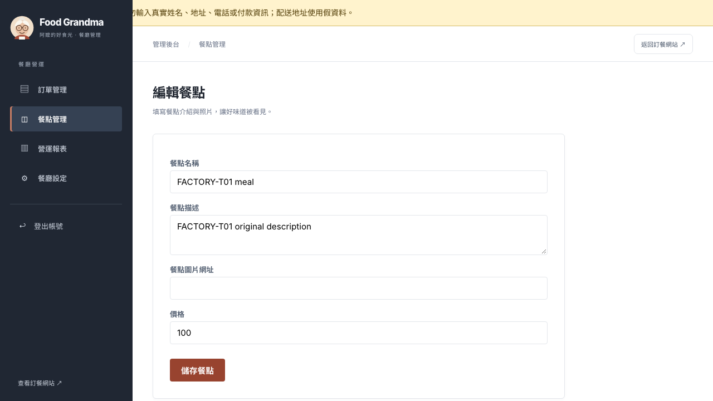
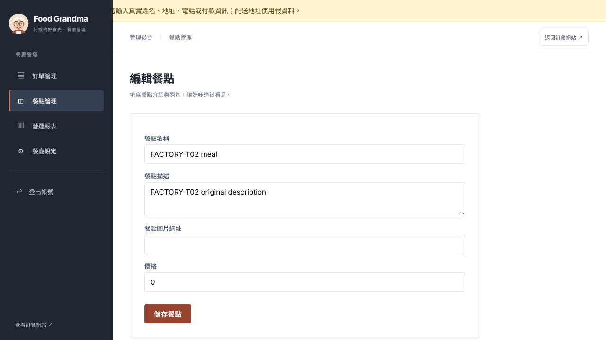

# v1 延伸實驗：五種模式的相同案例比較

2026 年 11 月 4 日（台灣時間）。五組 before／after 共 20 個真實 E2E，以及真實 API、Repository Fake 各 4 個契約案例，**28 個全部通過**。workers=1、retries=0，沒有跳過案例或預期失敗標記。程式第一次執行就通過，沒有修改預期結果來求通過。

## 這次比較的是什麼

原始 v1、v2、前次第 34／35 章實驗、產品、specs 與書稿均未修改。`baseline/` 是 v1 的未修改複本，本次只引用它的 API、Fixture 與 POM；沒有另外執行複本內原有的 27 個案例。

各組 before 是從 v1 的 MEAL-T02 操作順序延伸，另外共用 `support/meal-checks.ts` 的驗收檢查，方便確認模式改變後沒有少檢查。它們是本次撰寫的教學範例，不能說成原始 Generator 自行產生了這些 before／after。原始獨立生成的 v2 仍保留。

每組使用兩個相同情境：

- T01：原價 100，從網頁修改為 150。
- T02：原價 100，從網頁修改為 0，確認有效的零價格仍能儲存。

兩個都是「編輯既有餐點」，第二個不是 spec 中新增零元餐點的 MEAL-T04，而是本次另外安排的延伸輸入。各組以 FACTORY、FLOW、SCREEN、ADAPT、REPO 區分案例編號。

共同驗收要求如下：先確認名稱、描述、圖片網址與原價；從網頁儲存並收到該餐點的 HTTP 200 更新回應；列表顯示新價格；API 查詢仍是同一編號且其他欄位不變；編號清單不變、名稱沒有多出第二筆；重新開啟編輯頁面仍顯示新價格。

事後逐筆比對 before／after 的 observation.json，建立的資料、編號清單、更新回應、API 查詢及重新開啟後價格都完全相同。每個 E2E 都只有一筆瀏覽器 PUT，資料準備與查詢的 API context 沒有 PUT；沒有用 API 取代網頁修改價格。

表 1　各組結果與實際程式量

| 組別 | before | after | 逐案例觀察值 | 測試檔行數 before → after | 另外新增的實作行數 |
| --- | --- | --- | --- | --- | --- |
| page-factory | 2 passed | 2 passed | 完全相同 | 22 → 24 | 13 |
| workflow | 2 passed | 2 passed | 完全相同 | 22 → 16 | 28 |
| screenplay | 2 passed | 2 passed | 完全相同 | 22 → 20 | 42 |
| adapter | 2 passed | 2 passed | 完全相同 | 26 → 26 | 25 |
| repository | 2 passed | 2 passed | 完全相同 | 22 → 24 | 77 |

行數包含空白與註解，不含兩版共用的驗收程式。Repository 的新增實作行數包含真實 API 與 Fake 類別，不包含共用契約測試。這些數字只呈現程式分工，沒有測量日後維護時間。

## 1. Page Factory

before 直接建立 `MealsPage` 與 `MealFormPage`；after 由 `FoodGrandmaPages` 一次建立兩個原有 POM，操作步驟與驗收完全相同。

```ts
// before
const meals = new MealsPage(page);
const form = new MealFormPage(page);

// after
const pages = new FoodGrandmaPages(page);
const meals = pages.meals;
const form = pages.mealForm;
```

Factory 每次綁定目前測試的 page，沒有全域快取。實測兩邊都是 2/2 通過；after 的測試沒有變短，還多了 Factory 類別。這組能說明集中建立物件的方式，也能討論只有兩個簡單建構子時是否值得使用。

程式：[before](examples/page-factory/before.spec.ts)、[after](examples/page-factory/after.spec.ts)、[FoodGrandmaPages](examples/page-factory/food-grandma-pages.ts)。結果：[before](results/page-factory-before/case-outcomes.json)、[after](results/page-factory-after/case-outcomes.json)。

## 2. Workflow Facade

before 在測試內寫出開啟列表、選取餐點、填價、送出與等待回應。after 用兩個有名稱的方法組合這些步驟：

```ts
const workflow = new MealPriceWorkflow(page);
await workflow.openEditor(restaurant.token, original.id);
await expectOriginal(workflow.form, original);
const saved = await workflow.changePrice(original.id, scenario.price);
```

資料準備與驗收仍在測試及共用驗收程式，Facade 沒有把結果一併判定為成功。實測兩邊都是 2/2 通過，測試檔由 22 行變為 16 行，另增加 28 行流程實作。這裡可比較測試讀到的意圖，以及追查步驟時多開一份檔案的代價。

程式：[before](examples/workflow/before.spec.ts)、[after](examples/workflow/after.spec.ts)、[MealPriceWorkflow](examples/workflow/meal-price-workflow.ts)。結果：[before](results/workflow-before/case-outcomes.json)、[after](results/workflow-after/case-outcomes.json)。

## 3. Screenplay

before 直接使用 POM。after 使用最小的 Actor、Task、Question 結構，沿用同一組 v1 POM：

```ts
const restaurantActor = new Actor('餐廳管理者', page);
await restaurantActor.attemptsTo(OpenMealEditor(restaurant.token, original.id));
await expect.poll(() => restaurantActor.asks(MealDetails())).toEqual({
  name: original.name,
  short_description: original.short_description,
  image: original.image,
  price: '100',
});
```

`ChangeMealPrice` 是填價與送出的 Task，`MealDetails` 讀取原表單資料；預期仍由測試比較。兩個案例重複使用同一批 Task、Question，實測兩邊都是 2/2 通過。

這組展示角色、任務與查詢的拆分，只有一個操作網頁的角色，沒有實測跨角色旅程重組或大型 POM 的維護改善。測試檔少兩行，但多了 42 行支援程式，可以據此討論目前案例是否需要這層結構。

程式：[before](examples/screenplay/before.spec.ts)、[after](examples/screenplay/after.spec.ts)、[Actor／Task／Question](examples/screenplay/screenplay.ts)。結果：[before](results/screenplay-before/case-outcomes.json)、[after](results/screenplay-after/case-outcomes.json)。

## 4. Adapter

另外安排的呼叫端使用 title、description、imageUrl、amount，其中 amount 指餐點價格。v1 既有 Api 使用 name、short_description、image、price，且方法還需要 token。這個介面差異是教學前提，不是產品新需求或作者真實接手經驗。

before 在測試內轉換欄位並呼叫原 API；after 使用 `V1MealAdapter`，把欄位與參數差異集中：

```ts
const catalog = new V1MealAdapter(api, restaurant.token);
const original = await catalog.add(draft);
const idsBefore = (await catalog.all()).map((meal) => meal.id).sort((a, b) => a - b);
```

Adapter 沒有改動 v1 Api，也沒有接管網頁修改價格。兩邊都是 2/2 通過，建立出來的資料及最終結果完全相同。兩份測試檔都是 26 行，after 多一個 25 行 Adapter；價值在集中介面轉換，目前沒有程式量減少的證據。

程式：[before](examples/adapter/before.spec.ts)、[after](examples/adapter/after.spec.ts)、[V1MealAdapter](examples/adapter/v1-meal-adapter.ts)。結果：[before](results/adapter-before/case-outcomes.json)、[after](results/adapter-after/case-outcomes.json)。

## 5. Repository 與 Fake

### 真實 E2E 對照

before 直接用 v1 Api 準備及查詢餐點；after 透過 `MealsRepository` 與 `prepareMealForEditing`，但實際注入的是 `ApiMealsRepository`。兩邊都從網頁修改價格，都是 2/2 通過。

```ts
const repository = new ApiMealsRepository(api, request, restaurant.token);
const { original, idsBefore } = await prepareMealForEditing(repository, mealInput(caseId));
```

程式：[before](examples/repository/before.spec.ts)、[after](examples/repository/after.spec.ts)、[MealsRepository 與真實實作](examples/repository/meals-repository.ts)、[Fake](examples/repository/in-memory-meals-repository.ts)。

### 同一份契約案例，替換資料存取實作

四個案例都在 [同一份測試檔](examples/repository/contract/meal-repository.spec.ts)，透過 Fixture 注入真實 API 或記憶體 Fake。

表 2　Repository 的相同行為檢查

| 案例 | 檢查內容 | 真實 API | Fake |
| --- | --- | --- | --- |
| RCON-T01 | 共用資料準備程式建立後，能以回傳的編號查到原資料 | passed | passed |
| RCON-T02 | 更新原餐點價格，其他欄位、另一筆餐點及編號清單不變 | passed | passed |
| RCON-T03 | 找不到時回傳 undefined，更新時不新增資料 | passed | passed |
| RCON-T04 | 修改取得的物件，不會直接改動已儲存的資料 | passed | passed |

Fake 會實際保存資料、產生編號、查詢及更新，回傳資料副本；不是每次都回傳同一個成功物件。兩個實作使用各自回傳的編號，沒有要求不同資料來源的編號數值相同。

Fake 第一個執行，當時沒有啟動 18081、18082 服務，也未提供 TEST_PASSWORD，四個案例仍通過。從 trace 擷取的 HTTP 請求總數為 0；真實 API 的四個契約案例共留下 27 筆 API 請求。

這份契約限定本次共用資料程式需要的行為，不涵蓋登入、權限、HTTP 錯誤、網頁表單驗證或所有產品規則。Fake 通過不能取代前面的真實 E2E；真實 API 的 changePrice 只在契約案例使用。

結果：[真實 API](results/repository-contract-api/case-outcomes.json)、[Fake](results/repository-contract-fake/case-outcomes.json)。Fake 未啟動服務及未提供密碼的設定另見 [launch.json](results/repository-contract-fake/launch.json)。

## 實際執行步驟

1. 保存原始 v1、v2、前次實驗、規格與書稿的檔案雜湊，建立本次獨立資料夾。
2. 複製 v1 供引用，建立五組 before／after，固定兩個輸入情境及相同驗收程式。
3. 先執行 TypeScript 檢查，通過後，先跑不需要產品服務的四個 Fake 契約案例。
4. 透過原 FastAPI 的 Python 環境建立獨立帳號資料庫，初始沒有餐點或訂單。
5. 每個 E2E before／after 都另複製相同資料庫，啟動獨立 API，使用同一份產品程式執行兩個案例。所有案例均用一個 worker、不 retry。
6. 另複製初始資料庫，跑真實 API 的四個契約案例。
7. 從 Playwright trace 取出 console、network、API 請求與回應，保留步驟截圖；遮蔽密碼與 token。
8. 比對每組完整 observation.json，確認兩版原資料與驗收結果相同；檢查原始檔案未變，停止本次獨立服務。

本次實際使用的本機控制程式是 `./work/v1-pattern-extensions-20261104/run_all.py`，呼叫同資料夾的 runtime.py 準備環境，沒有在執行時改寫測試程式。完整 trace、所有截圖與本機重現腳本在 `./work/v1-pattern-extensions-20261104/evidence`。逐輪 results.json 與日誌、逐案例 API 證據已另整理到本資料夾的 results/，不依賴本機 trace 才能閱讀本報告。

在服務及帳號準備完成後，個別 Playwright 指令範例：

```bash
# macOS，在本 v1-pattern-labs 資料夾中執行；每組前後要重新準備獨立資料庫。
PATTERN_GROUP=page-factory PATTERN_VARIANT=before npx playwright test --workers=1 --retries=0
PATTERN_GROUP=page-factory PATTERN_VARIANT=after npx playwright test --workers=1 --retries=0

# 五組可選 page-factory、workflow、screenplay、adapter、repository。
# 契約檢查改用 repository-contract，分別注入 API 與 Fake。
PATTERN_GROUP=repository-contract REPOSITORY_KIND=api npx playwright test --workers=1 --retries=0
env -u TEST_PASSWORD PATTERN_GROUP=repository-contract REPOSITORY_KIND=fake npx playwright test --workers=1 --retries=0
```

Windows PowerShell 使用 `$env:PATTERN_GROUP='page-factory'`、`$env:PATTERN_VARIANT='before'` 設定相同參數，再執行 `npx playwright test --workers=1 --retries=0`。這次實測為 macOS，未宣稱已驗證 Windows。

## 結果圖與檔案



實驗圖 1　餐點資料載入後，原價格為 100。


實驗圖 2　第一個案例儲存並重新開啟後，價格為 150。



實驗圖 3　第二個案例儲存並重新開啟後，價格為 0。

圖片取自 Page Factory after 的本次實測；其餘四組的相同驗收觀察值已逐筆確認一致。程式組織改變不會在網頁上顯示不同模式名稱。

- [逐次結果 CSV](run-results.csv)：28 次案例執行。
- [摘要及保存檢查](summary.json)：案例數、比對結果、程式碼雜湊及環境。
- [共用驗收程式](support/meal-checks.ts)：兩版共用的 HTTP、畫面與 API 查詢檢查。
- [資料與範圍](product-context.md)：服務位址、認證與本次操作範圍。

只驗證這兩個 E2E 情境與四個 Repository 行為，沒有測量長期維護成本、多人協作或跨角色任務重組。本次沒有修改書稿，也沒有執行 commit／push。
